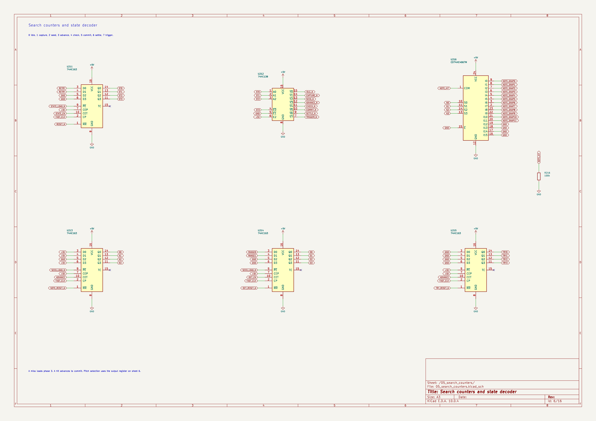

# Arpeggiator

a standalone arpeggiator made from analog circuits and logic chips. no microcontroller or firmware

there are 12 note switches, arranged like one octave of a piano. turn on the notes in a chord and it plays them in ascending order. a 1/2/3-octave selector sets how many octaves it plays before repeating

with C, E and G selected, the two-octave setting plays C, E, G, then the same notes an octave higher, then starts again

## controls

- 12 latching note switches and note LEDs
- 1/2/3-octave range selector
- tempo knob and start/stop button
- tuning, decay, tone and volume knobs
- sawtooth/pulse waveform switch
- mono line output on a 3.5 mm jack
- external DC power

## how it works

a clock sets the pace. a counter and logic circuit find the next selected note, skipping notes that are switched off. the note and octave are saved in a register so the pitch stays steady between steps

a precision voltage reference and resistor ladder set the note voltages. the selected voltage, plus an octave offset, controls an analog oscillator. an envelope controls each note's volume, followed by the tone control and output buffer

the controls and connectors will fit into a printed desktop case. the plan is one custom two-layer PCB, with through-hole controls and larger surface-mount parts where practical

## progress

the sequencer schematic is drawn. it covers the note switches, octave selector, clocks, input registers, counters, start/stop logic and note LEDs. the pitch is held in a register while the circuit looks for the next selected note

i checked the clocked logic against the expected note patterns, including range changes, empty selections and stopping during a search. KiCad ERC is clean for this section. the oscillator, pitch-voltage circuit, envelope, amplifier and main power supply still need to be added. no hardware has been built yet

## files

open [arpeggiator.kicad_pro](arpeggiator.kicad_pro) in KiCad. the [main schematic](arpeggiator.kicad_sch) links the circuit sheets in [schematic](schematic)

the current files are for the sequencer section. there is no PCB layout or fabrication package yet

[design notes](DESIGN.md)

[journal](JOURNAL.md)

[Half Life project](https://halflife.hackclub.com/projects/cmvfhc9ih000001o8aysnkf0b)

*made for Hack Club Half Life, music week*
