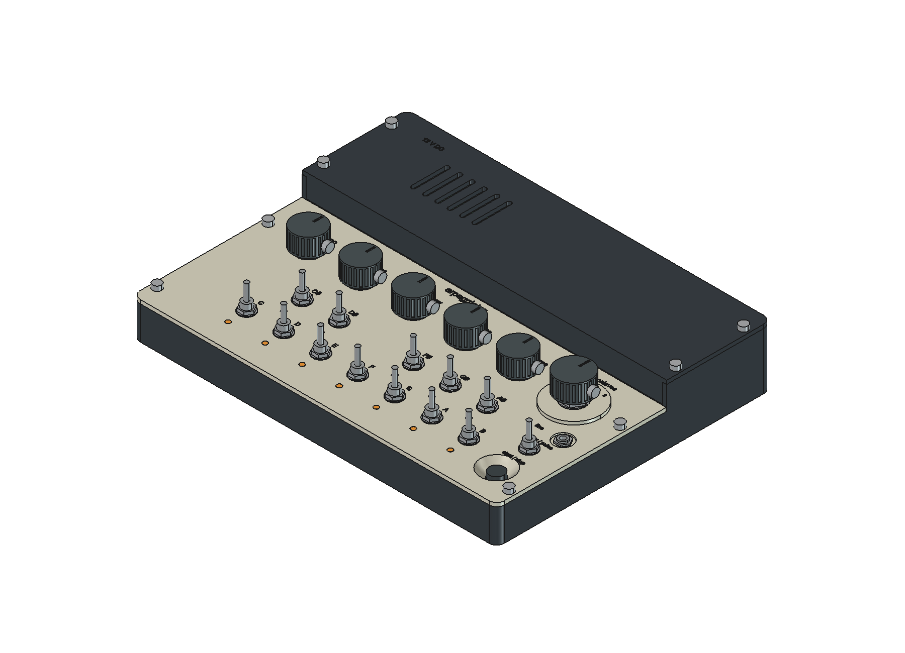
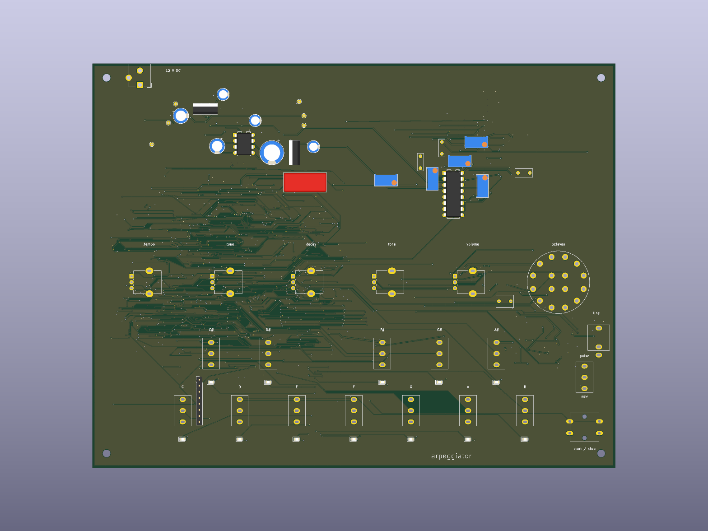
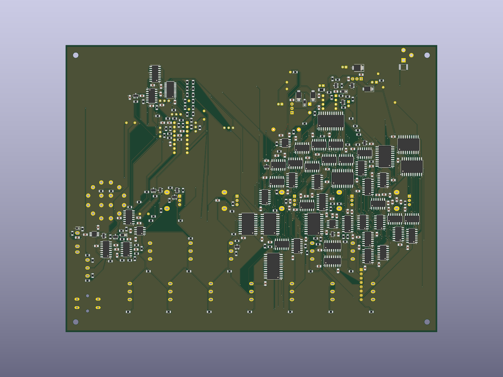
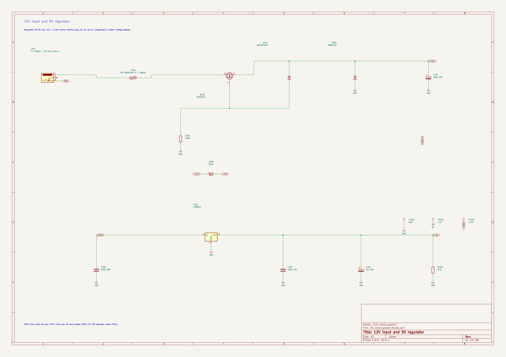

# Arpeggiator

a standalone arpeggiator made from analog circuits and logic chips. no microcontroller or firmware

there are 12 note switches, arranged like one octave of a piano. turn on the notes in a chord and it plays them in ascending order. a 1/2/3-octave selector sets how many octaves it plays before repeating

with C, E and G selected, the two-octave setting plays C, E, G, then the same notes an octave higher, then starts again

## controls

- 12 latching note switches and note LEDs
- 1/2/3-octave range selector
- tempo knob and start/stop button
- tuning, decay, tone and volume knobs
- sawtooth/pulse waveform switch
- mono line output on a 3.5 mm jack
- regulated 12V DC, centre-positive 5.5 x 2.1 mm plug

## how it works

a clock sets the pace. a counter and logic circuit find the next selected note, skipping notes that are switched off. the note and octave are saved in a register so the pitch stays steady between steps

a precision voltage reference and resistor ladder set the note voltages. the selected voltage, plus an octave offset, controls an analog oscillator. an envelope controls each note's volume, followed by the tone control and output buffer

the controls and connectors will fit into a printed desktop case. the plan is one custom four-layer PCB, with through-hole controls and larger surface-mount parts where practical

## progress

the PCB is routed. it's 220 x 170 mm, with four layers. the controls are on the front and most of the circuit is on the back

i started with two layers, but fitting all the ground connections around the signal tracks was getting awkward. the two inner ground planes made that much easier

the printed case is drawn too, with a removable rear cover for tuning. i'm getting the parts together now

[parts list](BOM.csv) · [buy quantities and prices](PURCHASES.csv)

some of the controls don't have 3D models yet

## files

open [arpeggiator.kicad_pro](arpeggiator.kicad_pro) in KiCad. the [main schematic](arpeggiator.kicad_sch) links the circuit sheets in [schematic](schematic)

[arpeggiator.kicad_pcb](arpeggiator.kicad_pcb) is the routed board. the [case files and assembly notes](case) include the FreeCAD model, STEP assembly and printable STLs

[fabrication files](fabrication) includes the Gerbers and bottom stencil for JLCPCB. the board uses 1 oz outer copper and 0.5 oz inner copper

[design notes](DESIGN.md)

[journal](JOURNAL.md)

[Half Life project](https://halflife.hackclub.com/projects/cmvfhc9ih000001o8aysnkf0b)

*made for Hack Club Half Life, music week*

## parts

[BOM.csv](BOM.csv) lists what goes into one build. [PURCHASES.csv](PURCHASES.csv) has the pack sizes and minimum quantities from the shops. the case and knobs use my own filament

full parts list

| qty | part | part number | supplier |
| ---: | --- | --- | --- |
| 4 | 74HC04 | 74HC04D,653 | [LCSC](https://www.lcsc.com/product-detail/C5590.html) |
| 8 | 74HC08 | 74HC08D,653 | [LCSC](https://www.lcsc.com/product-detail/C5593.html) |
| 1 | 74HC138 | 74HC138D,653 | [LCSC](https://www.lcsc.com/product-detail/C5602.html) |
| 4 | 74HC14 | 74HC14D,653 | [LCSC](https://www.lcsc.com/product-detail/C5605.html) |
| 1 | 74HC154 | CD74HC154M96 | [LCSC](https://www.lcsc.com/product-detail/C2832236.html) |
| 4 | 74HC163 | SN74HC163DR | [LCSC](https://www.lcsc.com/product-detail/C338758.html) |
| 7 | 74HC32 | 74HC32D,653 | [LCSC](https://www.lcsc.com/product-detail/C5632.html) |
| 3 | 74HC377 | 74HC377D,653 | [LCSC](https://www.lcsc.com/product-detail/C5639.html) |
| 1 | 74HC4051D | 74HC4051D,653 | [LCSC](https://www.lcsc.com/product-detail/C9386.html) |
| 4 | 74HC574 | 74HC574D,653 | [LCSC](https://www.lcsc.com/product-detail/C16501.html) |
| 3 | 74HC74 | 74HC74D,653 | [LCSC](https://www.lcsc.com/product-detail/C27597.html) |
| 2 | 74HC86 | 74HC86D,653 | [LCSC](https://www.lcsc.com/product-detail/C5955.html) |
| 1 | ADG706BRUZ | ADG706BRUZ-REEL7 | [LCSC](https://www.lcsc.com/product-detail/C408400.html) |
| 1 | AS3340A | AS3340A | [Infinite Machinery](https://infinitemachinery.com/as3340a) |
| 1 | CD74HC4067M | CD74HC4067M | [LCSC](https://www.lcsc.com/product-detail/C1545936.html) |
| 1 | L7805CV | L7805CV | [LCSC](https://www.lcsc.com/product-detail/C111887.html) |
| 1 | L7905CV | L7905CV | [LCSC](https://www.lcsc.com/product-detail/C111884.html) |
| 1 | LM13700M/NOPB | LM13700M/NOPB | [LCSC](https://www.lcsc.com/product-detail/C1346265.html) |
| 1 | LT1054CP | LT1054CP | [Mouser](https://www.mouser.com/en/ProductDetail/Texas-Instruments/LT1054CP?qs=p6YqzpSxLIw2yA3OFyb6XA%3D%3D) |
| 1 | MCP100T-450I/TT | MCP100T-450I/TT | [LCSC](https://www.lcsc.com/product-detail/C134467.html) |
| 2 | OPA4192IDR | OPA4192IDR | [LCSC](https://www.lcsc.com/product-detail/C2057908.html) |
| 1 | TL074HIDR | TL074HIDR | [LCSC](https://www.lcsc.com/product-detail/C2878713.html) |
| 2 | TL431BIDBZR | TL431BIDBZR | [LCSC](https://www.lcsc.com/product-detail/C41283.html) |
| 3 | TLC555IDR | TLC555IDR | [LCSC](https://www.lcsc.com/product-detail/C6987.html) |
| 1 | TMUX6219DGKRQ1 | TMUX6219DGKRQ1 | [LCSC](https://www.lcsc.com/product-detail/C3657022.html) |
| 1 | 1 / 2 / 3 octaves | SR2612F-0403-18R0B-D8-N | [Tayda](https://www.taydaelectronics.com/electromechanical/switches-key-pad/rotary-switch/rotary-switch-4-pole-3-position-alpha-sr2612f.html) |
| 1 | 1000u 25V | EEU-FR1E102 | [Mouser](https://www.mouser.com/en/ProductDetail/Panasonic/EEU-FR1E102?qs=Ao3mORb5HCARq2G4MnAlEQ%3D%3D) |
| 4 | 100k 0.01% 25ppm/C | RNCF0805TKT100K | [Mouser](https://www.mouser.com/en/ProductDetail/SEI-Stackpole/RNCF0805TKT100K?qs=IPgv5n7u5QbwSiCWZtnkOw%3D%3D) |
| 1 | 100k audio volume | RD901F-40-15F-A100K | [Tayda](https://www.taydaelectronics.com/100k-ohm-logarithmic-taper-potentiometer-d-shaft-pcb-9mm.html) |
| 1 | 100k coarse trim | 3296W-1-104LF | [LCSC](https://www.lcsc.com/product-detail/C48084.html) |
| 1 | 100k offset null | 3296W-1-104LF | [LCSC](https://www.lcsc.com/product-detail/C48084.html) |
| 1 | 100k tone | RD901F-40-15F-B100K | [Tayda](https://www.taydaelectronics.com/100k-ohm-linear-taper-potentiometer-d-shaft-pcb-9mm.html) |
| 1 | 100k tune | RD901F-40-15F-B100K | [Tayda](https://www.taydaelectronics.com/100k-ohm-linear-taper-potentiometer-d-shaft-pcb-9mm.html) |
| 2 | 100n film 100V 5% | R82EC3100DQ70J | [Tayda](https://www.taydaelectronics.com/0-1uf-100v-5-kemet-polyester-film-box-type-capacitor.html) |
| 2 | 100u 25V | EEU-FC1E101S | [Mouser](https://www.mouser.com/en/ProductDetail/Panasonic/EEU-FC1E101S?qs=XZT10BZ%2FaGG7SbPLggsp3w%3D%3D) |
| 4 | 10k 0.01% 25ppm/C | RNCF0805TKY10K0 | [Mouser](https://www.mouser.com/en/ProductDetail/SEI-Stackpole/RNCF0805TKY10K0?qs=FESYatJ8odKPVkqigBJMsg%3D%3D) |
| 1 | 10k tempco | 3296W-1-103LF | [Mouser](https://www.mouser.com/en/ProductDetail/Bourns/3296W-1-103LF?qs=CL3xLxiry19Id6AEaxYcng%3D%3D) |
| 1 | 1M decay | RD901F-40-15F-B1M | [Tayda](https://www.taydaelectronics.com/potentiometer-variable-resistors/rotary-potentiometer/linear/1m-ohm-linear-taper-potentiometer-d-shaft-pcb-9mm.html) |
| 1 | 1u film 63V 5% | R82DC4100DQ60J | [Tayda](https://www.taydaelectronics.com/1uf-63v-5-kemet-polyester-film-box-type-capacitor.html) |
| 1 | 2.2u film 100V 10% | MKS4D042204F00KSSD | [Tayda](https://www.taydaelectronics.com/capacitors/polyester-film-box-type-capacitors/wima-2200nf-2-2uf-100v-10-polyester-film-box-type-capacitor.html) |
| 1 | 20k HF track | 3296W-1-203LF | [LCSC](https://www.lcsc.com/product-detail/C34845.html) |
| 1 | 250k linear | RD901F-40-15F-B250K | [Tayda](https://www.taydaelectronics.com/potentiometer-variable-resistors/250k-ohm-linear-taper-potentiometer-d-shaft-pcb-9mm.html) |
| 2 | 2N7002 | 2N7002,215 | [LCSC](https://www.lcsc.com/product-detail/C65189.html) |
| 1 | 3.5mm mono line out | PJ-3001F | [Tayda](https://www.taydaelectronics.com/pj-3001f-3-5-mm-mono-phone-jack.html) |
| 1 | 470n film 63V 5% | R82DC3470AA60J | [Mouser](https://www.mouser.com/en/ProductDetail/KEMET/R82DC3470AA60J?qs=06HLYMEcjuWhk0f5YvbbSQ%3D%3D) |
| 3 | 47u 25V | 25YXJ47M5X11 | [Mouser](https://www.mouser.com/en/ProductDetail/Rubycon/25YXJ47M5X11?qs=T3oQrply3y%2F3J8S0Pc4Y1g%3D%3D) |
| 1 | 500 scale | 3296W-1-501LF | [Mouser](https://www.mouser.com/en/ProductDetail/Bourns/3296W-1-501LF?qs=jv1NtkgVBglZfwkzTzmOUg%3D%3D) |
| 1 | A | 1MS1T1B1M2QES | [Tayda](https://www.taydaelectronics.com/electromechanical/switches-key-pad/toggle-switch/mini-toggle-switch-spdt-on-none-on-pc-thru-hole.html) |
| 1 | A sharp | 1MS1T1B1M2QES | [Tayda](https://www.taydaelectronics.com/electromechanical/switches-key-pad/toggle-switch/mini-toggle-switch-spdt-on-none-on-pc-thru-hole.html) |
| 1 | AO3401A | AO3401A | [LCSC](https://www.lcsc.com/product-detail/C15127.html) |
| 1 | B | 1MS1T1B1M2QES | [Tayda](https://www.taydaelectronics.com/electromechanical/switches-key-pad/toggle-switch/mini-toggle-switch-spdt-on-none-on-pc-thru-hole.html) |
| 2 | BAT54GW | BAT54GWX | [LCSC](https://www.lcsc.com/product-detail/C5952163.html) |
| 1 | BAT54S,215 | BAT54S,215 | [LCSC](https://www.lcsc.com/product-detail/C47546.html) |
| 1 | BSS84 | BSS84,215 | [LCSC](https://www.lcsc.com/product-detail/C493579.html) |
| 1 | BZT52C8V2 | BZT52-C8V2J | [Mouser](https://www.mouser.com/en/ProductDetail/Nexperia/BZT52-C8V2J?qs=%252BEew9%252B0nqrCU1UOFPtFF2A%3D%3D) |
| 1 | C | 1MS1T1B1M2QES | [Tayda](https://www.taydaelectronics.com/electromechanical/switches-key-pad/toggle-switch/mini-toggle-switch-spdt-on-none-on-pc-thru-hole.html) |
| 1 | C sharp | 1MS1T1B1M2QES | [Tayda](https://www.taydaelectronics.com/electromechanical/switches-key-pad/toggle-switch/mini-toggle-switch-spdt-on-none-on-pc-thru-hole.html) |
| 1 | D | 1MS1T1B1M2QES | [Tayda](https://www.taydaelectronics.com/electromechanical/switches-key-pad/toggle-switch/mini-toggle-switch-spdt-on-none-on-pc-thru-hole.html) |
| 1 | D sharp | 1MS1T1B1M2QES | [Tayda](https://www.taydaelectronics.com/electromechanical/switches-key-pad/toggle-switch/mini-toggle-switch-spdt-on-none-on-pc-thru-hole.html) |
| 1 | E | 1MS1T1B1M2QES | [Tayda](https://www.taydaelectronics.com/electromechanical/switches-key-pad/toggle-switch/mini-toggle-switch-spdt-on-none-on-pc-thru-hole.html) |
| 1 | F | 1MS1T1B1M2QES | [Tayda](https://www.taydaelectronics.com/electromechanical/switches-key-pad/toggle-switch/mini-toggle-switch-spdt-on-none-on-pc-thru-hole.html) |
| 1 | F sharp | 1MS1T1B1M2QES | [Tayda](https://www.taydaelectronics.com/electromechanical/switches-key-pad/toggle-switch/mini-toggle-switch-spdt-on-none-on-pc-thru-hole.html) |
| 1 | G | 1MS1T1B1M2QES | [Tayda](https://www.taydaelectronics.com/electromechanical/switches-key-pad/toggle-switch/mini-toggle-switch-spdt-on-none-on-pc-thru-hole.html) |
| 1 | G sharp | 1MS1T1B1M2QES | [Tayda](https://www.taydaelectronics.com/electromechanical/switches-key-pad/toggle-switch/mini-toggle-switch-spdt-on-none-on-pc-thru-hole.html) |
| 1 | LM4040A25IDBZR | LM4040A25IDBZR | [LCSC](https://www.lcsc.com/product-detail/C9421.html) |
| 1 | MF-MSMF035/33X-2 / 350mA | MF-MSMF035/33X-2 | [Mouser](https://www.mouser.com/en/ProductDetail/Bourns/MF-MSMF035-33X-2?qs=CoAU%2FpHVZXxuOeHMuQc7RQ%3D%3D) |
| 2 | MMBT3904 | MMBT3904,215 | [LCSC](https://www.lcsc.com/product-detail/C426835.html) |
| 3 | MMBT3906 | MMBT3906,215 | [LCSC](https://www.lcsc.com/product-detail/C75549.html) |
| 1 | PESD5V0S1BA,115 | PESD5V0S1BA,115 | [LCSC](https://www.lcsc.com/product-detail/C19224.html) |
| 1 | PJ-102AH / 12V DC centre + | PJ-102AH | [Mouser](https://www.mouser.com/en/ProductDetail/Same-Sky/PJ-102AH?qs=WyjlAZoYn50Yq4CrVLCXLw%3D%3D) |
| 1 | SMBJ12A | SMBJ12A | [Mouser](https://www.mouser.com/en/ProductDetail/Littelfuse/SMBJ12A?qs=JJML70Qc14s9i3D6UUa43Q%3D%3D) |
| 3 | SS14 | SS14-E3/61T | [Mouser](https://www.mouser.com/en/ProductDetail/Vishay/SS14-E3-61T?qs=x2jpVgRnAtMLNL7KZbtr8g%3D%3D) |
| 1 | saw / pulse | 1MS1T1B1M2QES | [Tayda](https://www.taydaelectronics.com/electromechanical/switches-key-pad/toggle-switch/mini-toggle-switch-spdt-on-none-on-pc-thru-hole.html) |
| 1 | start / stop | B3F-4055 | [LCSC](https://www.lcsc.com/product-detail/C84931.html) |
| 1 | 1.1M 1% | RC0805FR-071M1L | [Mouser](https://www.mouser.com/en/ProductDetail/YAGEO/RC0805FR-071M1L?qs=g6xwsc4j%252B%2FrRMnxWx%2Fruqg%3D%3D) |
| 2 | 1.5M 1% | RC0805FR-071M5L | [Mouser](https://www.mouser.com/en/ProductDetail/YAGEO/RC0805FR-071M5L?qs=g6xwsc4j%252B%2FoVoMODI3Rz0Q%3D%3D) |
| 1 | 1.5k 1% | RC0805FR-071K5L | [Mouser](https://www.mouser.com/en/ProductDetail/YAGEO/RC0805FR-071K5L?qs=8Y8p%252BasKcI6LbaohOVk4HA%3D%3D) |
| 1 | 1.82M 0.1% | CPF0805B1M82E | [Mouser](https://www.mouser.com/en/ProductDetail/TE-Connectivity/CPF0805B1M82E?qs=CXI0wBT1M2hvtJld3NhfsA%3D%3D) |
| 1 | 1.8M 1% | ERJ-6ENF1804V | [Mouser](https://www.mouser.com/en/ProductDetail/Panasonic/ERJ-6ENF1804V?qs=JjxTDIFmKPTXgJmgM%2FyOiQ%3D%3D) |
| 1 | 100 0.1% | RT0805BRD07100RL | [Mouser](https://www.mouser.com/en/ProductDetail/YAGEO/RT0805BRD07100RL?qs=%2Ff7pOCXLR5dUTF5MWPONjg%3D%3D) |
| 11 | 100k 1% | RC0805FR-07100KL | [Mouser](https://www.mouser.com/en/ProductDetail/YAGEO/RC0805FR-07100KL?qs=8Y8p%252BasKcI7rEWn6FcVdAA%3D%3D) |
| 1 | 100n 5% | C0805C104J5RACTU | [Mouser](https://www.mouser.com/en/ProductDetail/KEMET/C0805C104J5RACTU?qs=gbgtKHXraGH15GhoNPXHBg%3D%3D) |
| 68 | 100n 50V X7R 10% | CC0805KRX7R9BB104 | [LCSC](https://www.lcsc.com/product-detail/C49678.html) |
| 5 | 100p C0G | C0805C101J5GACTU | [Mouser](https://www.mouser.com/en/ProductDetail/KEMET/C0805C101J5GACTU?qs=6pfgPk%252B7Yz7wCPQSSQ%2FBjg%3D%3D) |
| 2 | 10k 0.1% | RT0805BRD0710KL | [Mouser](https://www.mouser.com/en/ProductDetail/YAGEO/RT0805BRD0710KL?qs=87%2Fgv35YuOdOfU%252BBkLDVxA%3D%3D) |
| 1 | 10k 0.1% 25ppm/C | RT0805BRD0710KL | [Mouser](https://www.mouser.com/en/ProductDetail/YAGEO/RT0805BRD0710KL?qs=87%2Fgv35YuOdOfU%252BBkLDVxA%3D%3D) |
| 25 | 10k 1% | RC0805FR-0710KL | [Mouser](https://www.mouser.com/en/ProductDetail/YAGEO/RC0805FR-0710KL?qs=7bY8808IzHq6vrU3BeiiYw%3D%3D) |
| 6 | 10n | C0805C103J5GACTU | [LCSC](https://www.lcsc.com/product-detail/C2167597.html) |
| 1 | 10u 16V | GRM21BR61C106KE15L | [LCSC](https://www.lcsc.com/product-detail/C77075.html) |
| 1 | 15k 0.1% 25ppm/C | RT0805BRD0715KL | [Mouser](https://www.mouser.com/en/ProductDetail/YAGEO/RT0805BRD0715KL?qs=%2Ff7pOCXLR5foXQ1VlhQYhQ%3D%3D) |
| 1 | 174k 0.1% | RT0805BRD07174KL | [Mouser](https://www.mouser.com/en/ProductDetail/YAGEO/RT0805BRD07174KL?qs=4CyHz7GXqSj4xC7rYoRg0A%3D%3D) |
| 1 | 18.2k 1% | ERJ-6ENF1822V | [Mouser](https://www.mouser.com/en/ProductDetail/Panasonic/ERJ-6ENF1822V?qs=JjxTDIFmKPRzh6ImPVU9cQ%3D%3D) |
| 2 | 1M 1% | RC0805FR-071ML | [Mouser](https://www.mouser.com/en/ProductDetail/YAGEO/RC0805FR-071ML?qs=8Y8p%252BasKcI6wvSL4jxV1pQ%3D%3D) |
| 12 | 1k 0.1% | RT0805BRD071KL | [Mouser](https://www.mouser.com/en/ProductDetail/YAGEO/RT0805BRD071KL?qs=%2Ff7pOCXLR5e3FpClshTdPA%3D%3D) |
| 6 | 1k 1% | RC0805FR-071KL | [Mouser](https://www.mouser.com/en/ProductDetail/YAGEO/RC0805FR-071KL?qs=1ogmaHw32WJjeGY0DHXakQ%3D%3D) |
| 2 | 1n C0G | C0805C102J5GACTU | [Mouser](https://www.mouser.com/en/ProductDetail/KEMET/C0805C102J5GACTU?qs=yrVqjCObULOWvTzsHVJg1Q%3D%3D) |
| 12 | 1u 16V | CC0805KKX7R8BB105 | [Mouser](https://www.mouser.com/en/ProductDetail/YAGEO/CC0805KKX7R8BB105?qs=QENzi4TkIJ0C75LKGblEtw%3D%3D) |
| 14 | 2.2k 1% | RC0805FR-072K2L | [Mouser](https://www.mouser.com/en/ProductDetail/YAGEO/RC0805FR-072K2L?qs=CSLd874fYV2eT6iKTza3nw%3D%3D) |
| 1 | 2.32k 0.1% | RT0805BRD072K32L | [Mouser](https://www.mouser.com/en/ProductDetail/YAGEO/RT0805BRD072K32L?qs=4CyHz7GXqSgSJcxnTJ8TbQ%3D%3D) |
| 1 | 2.49k 1% | RC0805FR-072K49L | [Mouser](https://www.mouser.com/en/ProductDetail/YAGEO/RC0805FR-072K49L?qs=QrWOOBGzeCbaR%2FeulLJohg%3D%3D) |
| 1 | 200k 1% | RC0805FR-07200KL | [Mouser](https://www.mouser.com/en/ProductDetail/YAGEO/RC0805FR-07200KL?qs=8Y8p%252BasKcI4ufYuYh%252BmyZQ%3D%3D) |
| 1 | 20k 0.1% | RT0805BRD0720KL | [Mouser](https://www.mouser.com/en/ProductDetail/YAGEO/RT0805BRD0720KL?qs=87%2Fgv35YuOd%2FdRM1LyX3Lg%3D%3D) |
| 2 | 220 1% | RC0805FR-07220RL | [Mouser](https://www.mouser.com/en/ProductDetail/YAGEO/RC0805FR-07220RL?qs=KCkj9j0IqmXa4o%252BHKR6RGw%3D%3D) |
| 1 | 22k 1% | RC0805FR-0722KL | [Mouser](https://www.mouser.com/en/ProductDetail/YAGEO/RC0805FR-0722KL?qs=ngJqVwYVsdVbc7Rh0xIeHw%3D%3D) |
| 1 | 24k 1% | RC0805FR-0724KL | [Mouser](https://www.mouser.com/en/ProductDetail/YAGEO/RC0805FR-0724KL?qs=0OpHuDRjTADBsy5P0J6k2w%3D%3D) |
| 2 | 2k 0.1% | RT0805BRD072KL | [Mouser](https://www.mouser.com/en/ProductDetail/YAGEO/RT0805BRD072KL?qs=7JGxMcfkPok2189RXPA53g%3D%3D) |
| 1 | 2n C0G | C0805C202J5GACTU | [Mouser](https://www.mouser.com/en/ProductDetail/KEMET/C0805C202J5GACTU?qs=W4SVoLh3QChWIjbVvPwmQg%3D%3D) |
| 2 | 330k 0.1% | RT0805BRD07330KL | [Mouser](https://www.mouser.com/en/ProductDetail/YAGEO/RT0805BRD07330KL?qs=aZCcseWLxnuj6nToWrZKFA%3D%3D) |
| 1 | 330n 50V | C0805C334K5RACTU | [Mouser](https://www.mouser.com/en/ProductDetail/KEMET/C0805C334K5RACTU?qs=nRD1PKnFC2Hh3tSy%2FGeH2Q%3D%3D) |
| 1 | 33k 1% | RC0805FR-0733KL | [Mouser](https://www.mouser.com/en/ProductDetail/YAGEO/RC0805FR-0733KL?qs=BrN8wpjQTgGzZxKgikrwvw%3D%3D) |
| 1 | 33p C0G | C0805C330J5GACTU | [Mouser](https://www.mouser.com/en/ProductDetail/KEMET/C0805C330J5GACTU?qs=PVnqbTyV3SUE6Uu%252BkD9Iyg%3D%3D) |
| 1 | 360k 0.1% | RT0805BRD07360KL | [Mouser](https://www.mouser.com/en/ProductDetail/YAGEO/RT0805BRD07360KL?qs=aZCcseWLxnvpELpsSQnh8g%3D%3D) |
| 1 | 36k 1% | RC0805FR-0736KL | [Mouser](https://www.mouser.com/en/ProductDetail/YAGEO/RC0805FR-0736KL?qs=g6xwsc4j%252B%2Fq3CmSeyDlL7g%3D%3D) |
| 1 | 4.7 1% 0.25W | RC1206FR-074R7L | [Mouser](https://www.mouser.com/en/ProductDetail/YAGEO/RC1206FR-074R7L?qs=bz%2FLPVPAsTK5WyYax3BLuA%3D%3D) |
| 1 | 4.7u 25V X7R | GRM21BR71E475KA73L | [LCSC](https://www.lcsc.com/product-detail/C162427.html) |
| 2 | 470 1% | RC0805FR-07470RL | [Mouser](https://www.mouser.com/en/ProductDetail/YAGEO/RC0805FR-07470RL?qs=CSLd874fYV2wsnqMGLpcHA%3D%3D) |
| 5 | 47k 1% | RC0805FR-0747KL | [Mouser](https://www.mouser.com/en/ProductDetail/YAGEO/RC0805FR-0747KL?qs=sfaR5EV1ye7DERH7OnC2Gg%3D%3D) |
| 1 | 5.62k 0.1% | RT0805BRD075K62L | [Mouser](https://www.mouser.com/en/ProductDetail/YAGEO/RT0805BRD075K62L?qs=ylEn6CkgxuiWDc5aTJ638g%3D%3D) |
| 1 | 51k 1% | RC0805FR-0751KL | [Mouser](https://www.mouser.com/en/ProductDetail/YAGEO/RC0805FR-0751KL?qs=g6xwsc4j%252B%2FrUFmy6S6ALYQ%3D%3D) |
| 1 | 6.04k 0.1% | RT0805BRD076K04L | [Mouser](https://www.mouser.com/en/ProductDetail/YAGEO/RT0805BRD076K04L?qs=8SI67b7NHM5NwjLBwcP%252BXQ%3D%3D) |
| 1 | 6.49k 0.1% | RT0805BRD076K49L | [Mouser](https://www.mouser.com/en/ProductDetail/YAGEO/RT0805BRD076K49L?qs=4CyHz7GXqSiLdN4y1MhhhQ%3D%3D) |
| 1 | 820k 1% | RC0805FR-07820KL | [Mouser](https://www.mouser.com/en/ProductDetail/YAGEO/RC0805FR-07820KL?qs=g6xwsc4j%252B%2FozLzDoZP6Szg%3D%3D) |
| 2 | 910 1% | RC0805FR-07910RL | [Mouser](https://www.mouser.com/en/ProductDetail/YAGEO/RC0805FR-07910RL?qs=g6xwsc4j%252B%2FoZ2NamZOKACA%3D%3D) |
| 6 | copper test pad | - | with PCB |
| 1 | logic test header | M20-9990846 | [Mouser](https://www.mouser.com/en/ProductDetail/Harwin/M20-9990846?qs=ulE8k0yEMYb37YKanNqd%2FQ%3D%3D) |
| 12 | note LED, 0805 | APT2012SYCK | [Mouser](https://www.mouser.com/en/ProductDetail/Kingbright/APT2012SYCK?qs=y3UkhjaxUTb%252BLZXQu8d2yw%3D%3D) |
| 1 | four-layer PCB, 220 x 170 mm, 1.6 mm FR4, 1 oz outer / 0.5 oz inner | arpeggiator-jlcpcb | [JLCPCB](https://jlcpcb.com/pcb-fabrication/fr4-pcb) |
| 1 | printed tray, control panel, rear cover and octave collar | - | printed |
| 5 | printed pot knob | - | printed |
| 1 | regulated 12V DC adapter, >=0.5A, centre +, 5.5/2.1mm | SMI6B-12-4-P5 | [Mouser](https://www.mouser.com/en/ProductDetail/CUI-Inc/SMI6B-12-4-P5?qs=mAH9sUMRCtt8%252BS4f4Sapgw%3D%3D) |
| 1 | printed octave knob | - | printed |
| 18 | M3 x 8 mm socket-head screw | A-6393 | [Tayda](https://www.taydaelectronics.com/hardware-tools/nuts-washers-screws-spacers-and-more/screws/m3-hexagon-socket-head-cap-screw-3x8mm-grade-12-9.html) |
| 18 | M3 hex nut | Nut M3 | [Tayda](https://www.taydaelectronics.com/nut-3mm-for-screw-m3.html) |
| 4 | stick-on rubber foot, about 12 mm diameter | RF-1204 | [Tayda](https://www.taydaelectronics.com/rubber-feet-black-64pcs-block-size-12mmx4mm-for-enclosure.html) |
| 1 | clear 3 mm acrylic rod, at least 200 mm stock | a24061900ux1460 | [Harfington](https://www.harfington.com/products/p-1536182) |
| 1 | round black button cap | B32-1610 | [Mouser](https://www.mouser.com/en/ProductDetail/Aratas/B32-1610?qs=1tDaWCEHQQ6l3s6oDrKSiA%3D%3D) |
| 5 | M7 x 0.75 thin pot nut and washer | - | control hardware |
| 13 | 1/4-40 toggle nut and washer | - | control hardware |
| 1 | 3/8-32 NEF rotary nut and lockwasher | - | control hardware |
| 1 | M6 x 0.5 jack nut and washer | - | control hardware |
| 1 | bottom-side frameless stencil, 380 x 280 mm, 0.12 mm | arpeggiator-bottom-stencil | [JLCPCB](https://jlcpcb.com/pcb-stencil) |

