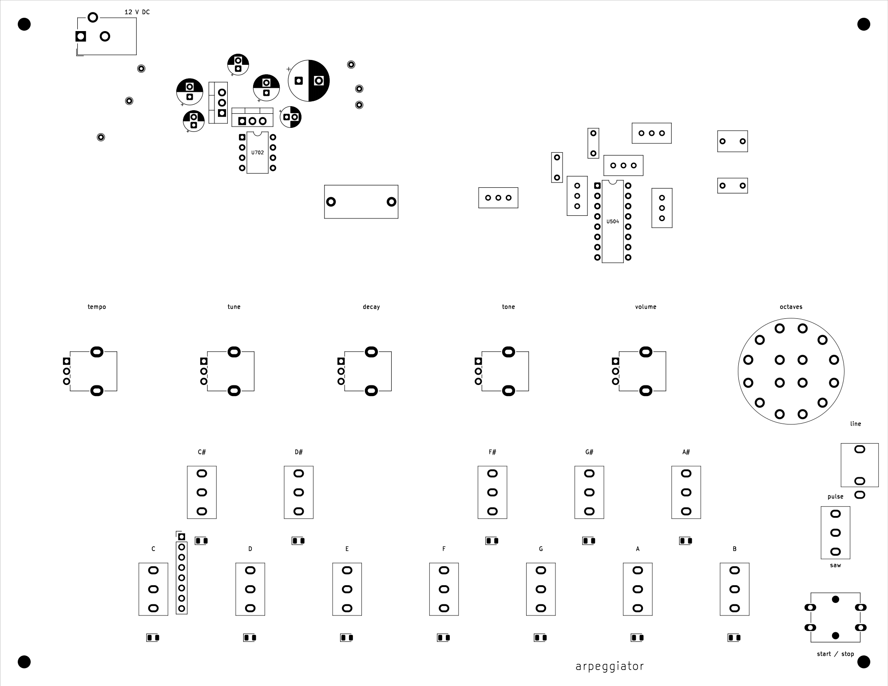

# Arpeggiator

a standalone arpeggiator made from analog circuits and logic chips. no microcontroller or firmware

there are 12 note switches, arranged like one octave of a piano. turn on the notes in a chord and it plays them in ascending order. a 1/2/3-octave selector sets how many octaves it plays before repeating

with C, E and G selected, the two-octave setting plays C, E, G, then the same notes an octave higher, then starts again

## controls

- 12 latching note switches and note LEDs
- 1/2/3-octave range selector
- tempo knob and start/stop button
- tuning, decay, tone and volume knobs
- sawtooth/pulse waveform switch
- mono line output on a 3.5 mm jack
- external DC power

## how it works

a clock sets the pace. a counter and logic circuit find the next selected note, skipping notes that are switched off. the note and octave are saved in a register so the pitch stays steady between steps

a precision voltage reference and resistor ladder set the note voltages. the selected voltage, plus an octave offset, controls an analog oscillator. an envelope controls each note's volume, followed by the tone control and output buffer

the controls and connectors will fit into a printed desktop case. the plan is one custom two-layer PCB, with through-hole controls and larger surface-mount parts where practical

## progress

the schematic is drawn and the first PCB placement is saved. the board is 220 x 170 mm with two copper layers. the controls go on the front, with most of the small circuit parts on the back

i picked the controls and film capacitors, checked the knob directions and made the missing footprints. ERC is clean. routing, the case and ordering are next. nothing has been built or tuned yet

[BOM.csv](BOM.csv) is the current parts list. the main chips, controls, connectors and film capacitors are selected. the remaining passives still need supplier part numbers, and prices have not been quoted yet

## files

open [arpeggiator.kicad_pro](arpeggiator.kicad_pro) in KiCad. the [main schematic](arpeggiator.kicad_sch) links the circuit sheets in [schematic](schematic)

[arpeggiator.kicad_pcb](arpeggiator.kicad_pcb) is the first placement. it has no routed tracks yet. the case and fabrication files are still to come

[design notes](DESIGN.md)

[journal](JOURNAL.md)

[Half Life project](https://halflife.hackclub.com/projects/cmvfhc9ih000001o8aysnkf0b)

*made for Hack Club Half Life, music week*
