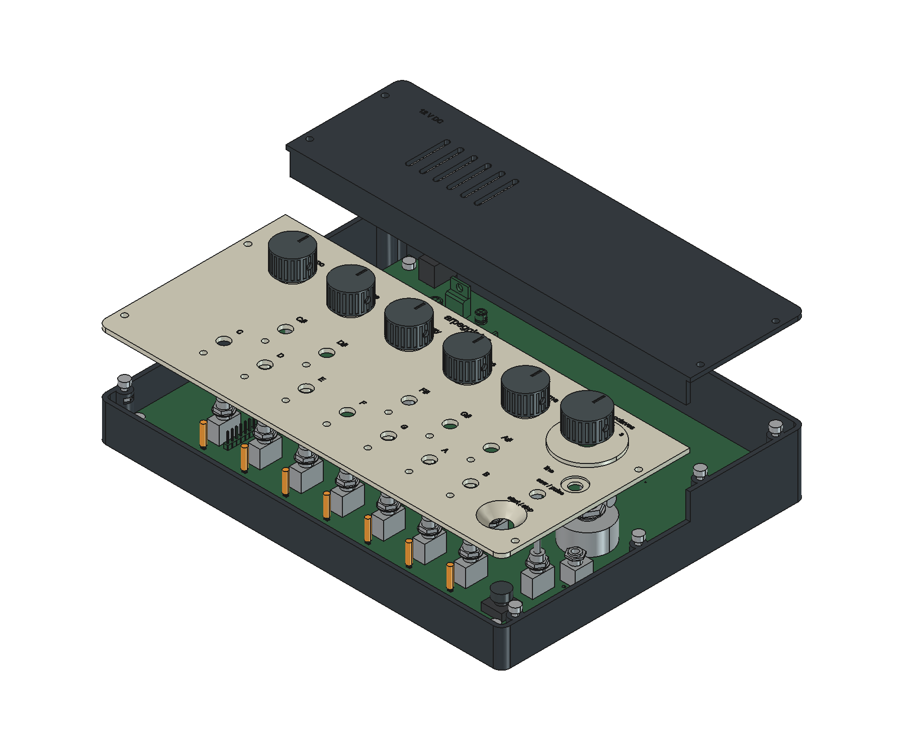

# case

a tray, a front panel and a taller cover over the power supply. the rear cover comes off to reach the tuning trimmers

## printing

open `arpeggiator-case.FCStd` to see the assembly. the STEP file is there too

print one of each STL, except `pot-knob.stl`, which needs five. the STLs are already turned the right way up for printing

use PETG-CF for the base and rear cover, and PLA for the front panel, collar and knobs. start with 0.2 mm layers, four walls and 25% infill. the largest part is 236 x 178 mm, so it fits the P1S

print the little fit coupon first. check the nut pocket and holes with the actual parts before printing the panel. the case hasn't been printed yet

## hardware

- 18 M3 x 8 mm socket-head screws and 18 M3 nuts, including the six knob screws
- four stick-on rubber feet, about 12 mm across
- twelve pieces of clear 3 mm acrylic rod, each 11.6 mm long, for the LEDs
- one Omron B32-1610 button cap
- mounting nuts and washers for the controls. use thin M7 pot nuts, at most 2 mm thick, with 0.5 mm washers. the jack uses a 1 mm nut. check which ones come with the parts before ordering extras

## putting it together

1. solder the board and trim the through-hole lead ends to 3 mm or less below the PCB. keep the control bodies flat against the board
2. slide four nuts into the PCB standoffs and eight into the lid posts. mount the board with four screws
3. fit the acrylic rods from the top of the panel. they rest on the little stops inside the guides. use a small amount of clear glue near the top of each guide to hold them, away from the LEDs
4. fit the button cap after soldering, then lower the panel over the controls. put the collar over the octave switch. secure the controls with their own nuts and washers, without overtightening
5. screw down the front panel. fit five small knobs and the larger octave knob, with an M3 nut in each knob's side pocket. the knob screws tighten against the shafts
6. set the rotary switch to the middle position and align its knob with 2. check the other two positions before tightening it
7. tune the board with the rear cover off, then fit the cover and feet

